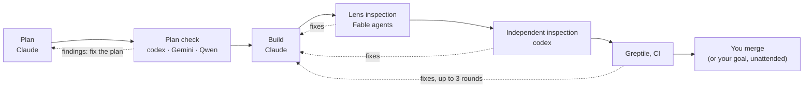
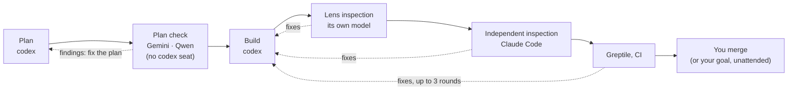
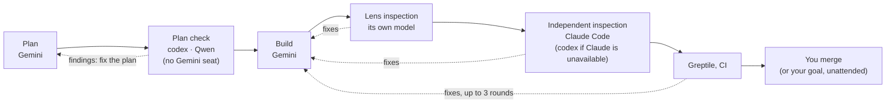

# Topping Out

[](https://github.com/kaithoughtarchitect/toppingout/actions/workflows/ci.yml) [](LICENSE)

**Go to bed with a ticket list, wake up to merged PRs, each with its proof. Topping Out is a spec-driven software factory that builds your product head by head: you name what it must do, it lays the jobs out on a board and builds them floor by floor, and when the board tops out you choose the next head. Nothing lives in a chat: every job starts a fresh session from files (the board, the handover, its work-session folder and a Logbook of every lesson so far), so the hundredth job knows what the first one learned and nothing drifts.**

No agent marks its own homework: a rival model family reads every plan and every change, and nothing merges without evidence. Each job runs as a planner/executor split, a foreman on Opus or Fable with a builder on any model, or as one master builder. It all runs in Orca, with Claude Code as the foreman. Every job ends with a record you can check: what was asked, what was built, what was tested and what the reviewers found.

> **The problem:** one agent plans, builds and then tells you it's done, so it marks its own homework. On a long job it drifts from the plan, every new session starts from nothing, and your best model spends your usage on typing.
>
> **What it does:** turns your product into heads and boards of jobs, keeps every job's context in files so each session starts knowing it, and keeps the checking away from whoever did the work. Other model families read the plan and the finished change, every claim needs a command, a commit or a test behind it, and you give the word for merges and pushes, or hand it over for one job or a night shift. On a hard job, or with a fast or cheap builder, the foreman plans and writes exact work orders so the builder can't drift; on a clear job, a master builder skips the handoffs.
>
> 🚀 **Try it:** clone this repo, then tell Claude Code, in your own project, to follow `skills/f-setup/SKILL.md` ([Try it](#try-it), below).
>
> 🔄 **Keep it current:** Topping Out improves almost daily. Between jobs, type **`/f-setup`** in your project: it shows what's new, applies it on your yes and keeps everything you've adapted. The end of every job tells you when there's an update ([Updating](#updating)).

Site: [toppingout.dev](https://toppingout.dev) · Repo: [github.com/kaithoughtarchitect/toppingout](https://github.com/kaithoughtarchitect/toppingout)

## What a finished job looks like

One real job, run on its own from ticket to merge (an autonomous run; the project's name and feature are left out):

```text
ticket      one feature, one branch, one PR
plan check  5 findings from a cross-family reader, 4 applied before building
build       work orders written by the foreman, built test-first by the builder you chose
inspect 1   lens inspection: 18 fixes found and accepted
inspect 2   independent review (another model family): no findings
review      Greptile 5/5
tests       831 -> 848 passing; no test red at head that was green at base
probes      18 of 18 mutation probes caught (each removes a guard; the tests must fail)
merge       merged tree identical to the reviewed tree
spend       at most 1.34 USD in paid calls, against a 3 USD cap
record      acceptance ledger, both inspections, base-vs-head runs, lessons saved as cards
```

Every job's PR is titled the same way, `J<N> · board <id>: <what it delivers>`, so you can tell which job and board it came from (`METHOD.md` §10).

## Try it

You need `git`, Node 18+, Python 3.9+, Bash and Claude Code, plus a builder (Pi, Claude Code or agy), Pi for the plan check, the codex CLI, an OpenRouter key and the Greptile app ([What you need](#what-you-need) says what each is for).

**How to start:**

1. `git clone https://github.com/kaithoughtarchitect/toppingout`
2. In Claude Code, in the repo that will hold your records, say: `Read <path to toppingout>/skills/f-setup/SKILL.md and follow it`. It checks each tool, installs the skills and templates, writes a profile of your repo and asks only what it can't find out (`SETUP.md` §1).
3. Start your first job the way `/f-setup` ends by suggesting: `/f-survey` to turn an idea into a ticket, `/f-schedule` to cut a big plan into tickets, or the first-job opener for a ticket you already have (`SETUP.md` §7).
4. **Keep it current:** between jobs, type `/f-setup` again. Topping Out changes often, and the end of every job tells you when there's something new ([Updating](#updating)).

You don't need the whole flow first: the foreman follows `METHOD.md`, and you answer when it asks.

## What you need

| You need | For | |
|---|---|---|
| Claude Code, on your Claude subscription | the foreman (the tested one) | required |
| `git`, Node 18+, Python 3.9+, Bash | the installer, the checks and the work orders | required; `/f-setup` checks each |
| A builder: Pi, Claude Code (any Claude model) or Antigravity's agy CLI (any model it lists) | the coding; a master builder can also be a codex session | required, any one (`Builder-Playbook.md`) |
| Pi | the plan check's OpenRouter readers and `agent-council` | required |
| Orca | the pane link: the foreman sends each step to the builder in the pane beside it. Autonomous runs and night shifts run through it | needed to run without you; without it you paste one line per step (`SETUP.md` §4) |
| Codex: the codex CLI, signed in with your ChatGPT subscription | the second model family: the independent review, and the `sol` plan-check seat (GPT-6.2 Sol), at no per-call cost | required (`METHOD.md` §8); carrying the brief to that session by hand also works |
| An OpenRouter key | the plan check's other readers (`qwen4-max`), the councils, voice | required; paid calls only within the cap you set, and tests always run with paid keys stripped |
| The Greptile app on your repo | up to three review rounds on every PR (`skills/f-greploop`) | required |
| Antigravity: the agy CLI, signed in with your Antigravity subscription | a builder option (Gemini Hydrogen), and the `gemini-hydrogen-agy` plan-check seat at no per-call cost, seated by default in unattended runs | optional; without it that seat runs on OpenRouter |
| A Linux server and Tailscale | running jobs while your computer sleeps (`SETUP.md` §8b) | optional |

**Tested on** Windows 11 with Claude Code as the foreman, Git Bash, Node 22 and Python 3.12, on real codebases since September 2026, and on an Ubuntu 24.04 server through Orca. macOS and desktop Linux are expected to work (the scripts are Node, Python and Bash) but aren't verified yet: `SETUP.md` §9, "Tested setup".

## One job, from your side

1. Give the foreman a ticket: a tracker link, or a short `TICKET-<nn>-<slug>.md` (`/f-survey` turns an idea into one).
2. It walks the site (re-checks the handover, the repo and the live ticket), then asks for your **"go"** (or "go, master builder" / "go, foreman" to change the crew, which then carries over to the next jobs).
3. It writes work orders; you paste each pointer into the builder (or the pane link does it), until the build, the two inspections and the acceptance ledger are done. A master builder builds it itself, with no pointers to paste.
4. On your word ("open the PR") it opens the PR and runs up to three Greptile review rounds on it. You say **"merge"** when the evidence satisfies you.
5. It closes the job, saves the lessons, and proposes the next ticket for you to confirm.

## Two ways to staff a job: foreman and builder, or a master builder

| | Foreman and builder (the default) | Master builder |
|---|---|---|
| **Use it when** | the job is hard, risky or long; you want the strongest guarantees; or you want a fast or cheap builder | the job is clear, and the model doing it is strong enough to plan as well as build |
| **Why** | a strong foreman plans, writes exact work orders and reviews every step, so a fast or less capable builder can't drift or make design calls | no handoffs and no work orders, so it should be faster; the same plan check, inspections, Greptile, CI and your merge still apply |
| **The model** | the foreman on Opus or Fable; the builder on anything | one strong model doing both; a fast or cheap model isn't a good fit here, because nobody plans for it |

Pick it at "go" ("go, master builder"), or add `, master builder` to an autonomous run's or a night shift's goal. Your choice carries over to the next jobs until you say "go, foreman" (`METHOD.md`, "The crew carries over").

**Who reads what, by master builder.** The dotted arrows are the repair loops: every accepted finding goes back to the master builder to fix, test-first, and is checked again (Greptile at most three rounds). In an autonomous run or a night shift the loops run without you, and your goal's words stand in for "merge". The plan check seats are your standing choice minus the master builder's own family (here the default three: `sol` on codex, `gemini-hydrogen-agy` on agy, `qwen4-max` on OpenRouter). The independent inspection runs on that tool's default model.

**A master builder in Claude Code** (Opus or Fable):



**A master builder in codex:**



**A master builder in agy, on a Gemini model** (agy on a Claude model reads like the Claude Code chart, with the lens on its own model):



## Three ways to run a job

Work orders reach the builder as a one-line pointer: you paste it, or the foreman sends it over the pane link (a master builder has none). Any of the three can run as a master builder: say so at "go", or add `, master builder` to the goal; the choice carries over until you say "go, foreman".

- **👤 With you:** you paste the job's opener into a fresh session and give each word yourself.
- **🤖 An autonomous run:** `/goal autonomous run: <path to the job's opener>, until done or stopped`. With an autonomous-run goal, a job runs to the merge without you (with the pane link carrying the pointers), inside the grants `RULES.md` ("The one exception") lists. It repairs what goes red and stops only on the conditions listed there. Any other standing goal grants nothing.
- **🌙 A night shift:** `/goal night shift: jobs 13, 17, until done or stopped` runs several autonomous runs in a row, each in a fresh session, and leaves you a morning report. It needs Orca. Any stop in a job ends the shift (`RULES.md`, "A night shift").

When a job's end game is done and another job is next, the foreman ends with a **🚧 YOUR CALL · how does job <N> run?** card: the three ways, ★ on the recommended one, each with its line ready to paste. It's skipped under a goal, where nobody is there to answer, and after a topping out, where you pick the next head instead (`skills/f-signoff`).

**Two lanes** (optional, off by default, not yet tried on a real project): two jobs at once on two machines, offered on a **🚧 YOUR CALL · one lane or two?** card at the end of every `/f-schedule` proposal (`METHOD.md` §13, "Two lanes").

## Words you'll see

The roles and the name come from the building site.

- **Owner:** you. Your word is needed for merges, pushes and the other acts `RULES.md` lists.
- **Foreman:** the session that plans, writes work orders and checks the work. It never writes product code. The skill names start with `f-`, for foreman.
- **Builder:** the session that writes the code, one work order at a time, on the model you pick for the job: a frontier model, a fast one or a cheap one.
- **Master builder:** a builder that plans the job and builds it in one session, when you choose it (at "go", or in an autonomous run's or night shift's goal); your choice carries over to the next jobs until you change it. No foreman and no work orders; the plan check, the lens inspection, an independent inspection from another model family, Greptile and your merge all stay (`METHOD.md`, "MASTER BUILDER").
- **Inspectors:** fresh review sessions that only report. The **lens inspection** runs one review agent per angle (tests, errors, types and more, `agents/lens-*.md`); the **independent inspection** is a session from another model family.
- **Work order:** a file with one or several exact tasks, each with its tests and its own commit. The builder gets a one-line pointer to it.
- **Site walk:** the foreman's check at the start of a job that the handover still matches the repo and the live ticket.
- **Plan check:** a cold read of the plan (the foreman's, or the master builder's) by readers from other model families, before any code (`/f-plancheck`).
- **Acceptance ledger:** every requirement and check with its evidence. Every row must read PASS before the merge.
- **Board and head:** a project's jobs drawn as a fishbone. The head is what the product must do when every job is done.
- **Topping out:** the ceremony when a building's last beam goes on; here, when a board reaches its head.
- **Pane link:** Orca running the foreman and the builder side by side, so pointers pass without you (`skills/orca-pi-connect`).

---

## The idea in seven lines

1. **One ticket = one job = one branch = one PR.**
2. **The foreman never writes product code; the builder never makes design decisions.** The one exception is a master builder job, which you choose at "go": one session plans and builds, and everyone who checks it is someone else.
3. **Everything goes through files.** Work orders are files, reports are files, reviews are files. The builder gets a one-line pointer (from the owner, or sent over a pane link by the foreman), never pasted text.
4. **Disk before words.** After every builder step, the foreman checks commits, captures and files on disk *before* it reads the builder's report.
5. **Every claim carries its evidence:** a command and its output, a commit hash, a test name. A claim without evidence counts as not done.
6. **Some acts need the owner's word, typed in the session.** These are approval boundaries, not all of them irreversible: merging and pushes, tracker transitions, messages, branch and worktree deletion, edits outside the ticket's files, migrations, and a fourth Greptile round on one PR. A message relayed by voice is never the owner's word. The full list, and the exceptions, are in `RULES.md`.
7. **Every reply ends with the 5-line status block** (`templates/J-STATUS.md`).

---

## The flow at a glance

<picture>
  <source media="(prefers-color-scheme: dark)" srcset="assets/readme/flow-dark.webp">
  <source media="(prefers-color-scheme: light)" srcset="assets/readme/flow-light.webp">
  
</picture>

<details>
<summary><b>Full detail: every step</b></summary>

This is the foreman and builder. A master builder job runs the same checks in one session, without the work orders (`METHOD.md`, "MASTER BUILDER").

**Before any job**, a big plan is cut into tickets: `/f-survey` → `/f-blueprint` → **`/f-plancheck`** (cold cross-family read) → **`/f-schedule`** (project, one ticket per job, the project board, a width report, one lane or two). Each job below builds **one** ticket (`METHOD.md` §13).

```
 SHIFT HANDOVER + OPENER ──> SITE WALK ──> [owner: "go"]
                                          │
          BUILDER PRE-FLIGHT (read-only env check) ── READY / BLOCKED
                                          │
 WORK ORDER 1  setup + baseline (worktree, job file, t0 captures) ── no code
                                          │
 GATE 1   /f-plancheck on the foreman's own plan (cold seats, other families; before work order 2)
                                          │
 WORK ORDER 2  "plan in force + T1" (the foreman wrote and validated the plan)
                                          │
 WORK ORDER 3..N  one or several decision-complete tasks per work order, test-first, one commit per task
      │  after EACH: disk check → work order review (re-probe, verify test-first, switch-rule line)
      │  next work orders drafted while the current one runs
                                          │
 BASE-VS-HEAD  builder work order (the tests that use what changed); any red-at-head-only = STOP, foreman characterises
 GATE 2   foreman reviews every commit + checks the builder's base-vs-head on disk
 LENS INSP.    foreman runs /f-inspect in its own session (fresh lens agents) ──> checks each finding ──> repair work orders (QUICK: skipped)
                                          │
 CROSS-MODEL   foreman /pack-review (checks its own brief) ──> fresh session of another
               family runs /xreview ──> foreman /adjudicate ──> repair work orders
 FINAL RE-RUN  after the last repair (repairs re-run only what they touch): captures, probes, base-vs-head; the whole suite once (builder), each red test labelled
 ACCEPTANCE LEDGER  no FAIL/UNTESTED/INCONCLUSIVE/blank to open the PR; every requirement row PASS (CI green at the final head) to merge
                                          │
 PR opened (owner watches it in the browser) ──> /f-greploop: ≤3 Greptile rounds
      (adjudicate → builder repairs → affected tests + ledger re-run → push → CI runs the whole suite) ──> PR description check
                                          │
 [owner: "merge"]
                                          │
 /f-signoff (+ Logbook cards) ──> dev report ──> next-ticket decision ──> you confirm ──> /f-board close ──> handover + opener ──> records push
                                          │
 when every job on the board is done: TOP OUT: close the last job ──> topout (board frozen as the record) ──> topping out report ──> candidate next heads
                                          │
 [owner picks a head] ──> /f-survey ──> /f-blueprint ──> /f-plancheck ──> /f-schedule ──> a new board, and the loop starts again
```

</details>

## Topping out

When a board reaches its head (every job merged or resolved), the end game freezes it as the project's record, writes what was built and what's carried over, and offers three to five candidate next heads. You pick one, whenever you're ready, and the cycle starts again on a new board (`METHOD.md` §11b). Work found while testing a product goes on an **iteration board** instead: no blueprint, small jobs added as you find them.

## The board


*A made-up project board (`examples/example-board/board.html`). On top, the head: what the product must do. Then "Needs you": every decision and owed item waiting on you, and what to set up before the next job runs. Then the job running now. Below, every line off the spine is one job: solid is merged, yellow is in progress or next, dotted is blocked; the icons beside a number are what that job needs to run.*

**Tags say what a job needs to run:** 🌐 a browser, 👤 you present, 🖥️ a screen, 🔑 a login (named by the variable that holds it, never the password itself), plus the machine's needs (Docker, Postgres, a GPU). Before an autonomous run or a night shift, the board's "Needs you" lists what to set up, and the shift's pre-flight skips a job it can't run (say, one that needs you, or a login that isn't in `.env`) and tells you why in the morning, instead of stalling on it.

---

## What it is not

- **Not autonomous by default.** By default you give the word for every push, PR, review round and merge (except the job's own cleanup and records push after a verified merge): the owner is the one piece a confident report can't talk round. **Autonomy comes only from an explicit grant:** an autonomous run (`/goal autonomous run: <path to the job's opener>`) or a night shift covers exactly the acts `RULES.md` ("The one exception") lists, for the jobs it names, and repairs what goes red and stops only on the conditions listed there. A standing goal never covers the other gated acts.
- **Not a second judge on top of the foreman.** Reviews are layered by *independence* (a fresh session, a different reader), not by stacking graders. Separate reviewers reduce some failure modes; they don't guarantee correct code.
- **Not tied to one builder.** Any agent that can read a file, run a shell and write a report can build. Every builder gets the same kind of work order (`Builder-Playbook.md`). In Orca the foreman drives it in the pane beside it: Pi, Claude Code running whichever Claude model you choose, or agy (Antigravity's CLI) running any model it lists (`SETUP.md` §4).

## What software enforces, and what is only instructed

Most of the method is instructions the agents follow; a few checks are scripts that refuse. Know which is which:

| Promise | Enforced today by | What is not prevented |
|---|---|---|
| Gated acts (push, merge, messages) wait for your word | **instruction** (`RULES.md`), plus your coding tool's own permission prompts. The package ships no hook that blocks a gated act | an agent with push rights and pre-allowed commands can push; nothing in the package blocks it technically. `SETUP.md` §5 suggests a hook for migrations only, and `SETUP.md` §7 asks you to pre-allow `git push`, `gh pr create` and `gh pr merge` for an autonomous run |
| A voice message never stands in for your word | **a script in the voice add-on, plus instruction:** Topping Out Gaffer refuses to send a message that is only a gated act ("merge", "push", "open the PR", "greploop") and marks every message it sends `[voice]` (`addons/gaffer/brain.ts`); `RULES.md` says a `[voice]` message is never the owner's word | the refusal covers only a message that is the gated act alone; any other `[voice]` message reaches the session, where only the instruction stops it |
| What merged is what was reviewed | **a check the foreman runs:** the merged commit's tree must equal the reviewed and tested tree (`METHOD.md` §10 step 3), and `skills/f-signoff/endgame.mjs verify-merge` refuses a close whose merge isn't on the main branch | with one lane the tree comparison is not scripted (in lane mode `snippets/land_tested.sh` refuses to push a merge whose tree differs from the proven head's, and its `verify` checks the landed merge), and `verify-merge` checks only that the merge commit is on main (and runs because `/f-signoff` calls it); an edit after the final re-run invalidates the acceptance and is caught only if the foreman re-runs, as the rules require |
| Nothing new starts until a closed job's end game is done | **a script the skills run:** `endgame.mjs` keeps a lock file (one per lane with two lanes); the planning skills and work order 1 run its `check` and stop while it exists | an agent that skips the `check` call isn't stopped |
| The review is independent | **a script, when used:** `scripts/cross-review-dispatch.mjs` seats the reviewer on another vendor's CLI, in a separate process, from a brief (`/pack-review`) | the foreman (or the master builder) writes the brief, so it chooses what the reviewer is pointed at and told (the reviewer can also read the checkout, read-only); seats exist only for Claude, codex and Gemini hosts; this is separation, not adversarial isolation |
| The whole ask is done | **instruction plus a record:** the acceptance ledger lists every requirement and check with its evidence, and `/f-signoff` refuses unless every row is PASS. A change to the ask is recorded in the owner's own words (`METHOD.md` §2) | the ledger is written and checked by agents; a wrong PASS is caught only by the reviews or by you |
| Builder names stay out of the records | **a script the foreman runs:** `skills/f-signoff/names-check.mjs` checks every staged record at the records push and exits non-zero on a hit | it runs only when the foreman calls it at the records push; it checks only the names in your names file, and skips allowed contexts and rendered board pages |

## Updating

**Run `/f-setup` between jobs to stay current.** It takes the newest Topping Out from this repo's `main` (you don't wait for a release; releases are dated snapshots of the same changes), and the end of every job tells you when there's something new (the next-job card's ⬆️ line; after a night shift, the morning summary). In your project, **between jobs**, type `/f-setup`. It pulls the newest Topping Out, shows what's new (`CHANGELOG.md`), applies it on your yes, keeps every file you've adapted, and commits exactly the changed files on your word; read-only check at any time: `node <path to toppingout>/skills/f-setup/install.mjs --repo . --check` (`SETUP.md` §1, "Upgrade").

## Read next

| If you are... | Read |
|---|---|
| A new foreman | this README → `RULES.md` → `METHOD.md` → `OVERRIDES.md` → `Foreman-Playbook.md` → `Builder-Playbook.md` → `templates/` |
| The owner | this README → `METHOD.md` §"The owner's loop" → `Builder-Playbook.md` |
| Setting it up in a new repo | `SETUP.md` |
| Choosing or running a builder | `Builder-Playbook.md` |
| Choosing who does a job: foreman and builder, or a master builder | "Two ways to staff a job" above → `METHOD.md`, "MASTER BUILDER" |

## Folder map

| Path | What it is |
|---|---|
| `METHOD.md` | the full method, stage by stage, with the "why" behind each step |
| `RULES.md` | the non-negotiables, and the list of acts that need the owner's word |
| `OVERRIDES.md` | where the method beats the bundled skills and agents |
| `SETUP.md` | installing, requirements, the tested setup |
| `Foreman-Playbook.md`, `Builder-Playbook.md` | how to do the foreman's part well, and how to run any builder |
| `CHANGELOG.md`, `ROADMAP.md`, `CONTRIBUTING.md` | what changed, what's next, how to help |
| `DESIGN.md` | the look every Topping Out page shares |
| `flow.html` | the whole flow as one picture: 46 steps in seven stages (open in a browser) |
| `skills/` | the 30 skills, each with a `SKILL.md` |
| `agents/` | the review lenses and helper agents the skills call |
| `templates/`, `snippets/` | fill-in-the-blanks for every document the method writes, and code to copy |
| `scripts/` | the review dispatcher, the voice scripts and the generators for the site, the wiki and the flow page |
| `skills-wiki/` | the map of every skill and agent (`skills-wiki/index.md`) |
| `examples/example-board/` | a made-up project board: open `board.html` |
| `foreman/` | the Logbook, the blueprints index and the job templates a project starts with |
| `addons/deep-agents/` | **optional:** for an AI agent built on LangChain, LangGraph or Deep Agents; `/f-setup` installs it only on yes (`addons/deep-agents/README.md`) |
| `addons/gaffer/` | **optional, in this repo only (not installed):** Topping Out Gaffer, a voice agent that runs on your machine for your boards and live Orca sessions; needs an OpenRouter key (`addons/gaffer/README.md`, `SETUP.md` §8c) |
| `docs/`, `assets/` | the site at toppingout.dev, generated by `scripts/build_site.py`, and its images |

Every folder in detail: `SETUP.md` §1, "The package, folder by folder". What Topping Out adds to your repo, and where a job's files go: `SETUP.md` §2.

## Precedence

When two sources disagree: **the owner's own words → `RULES.md` → `METHOD.md` → `OVERRIDES.md` → `SETUP.md` → `Foreman-Playbook.md` (the why behind the foreman rules in `RULES.md`) / `Builder-Playbook.md` → `templates/` → the bundled `skills/` and `agents/`.** The bundled skills and agents are general; `OVERRIDES.md` lists exactly where the method beats them.

If this saves you a babysitting session, a star helps others find it.

## Licence

MIT. See `LICENSE`.
