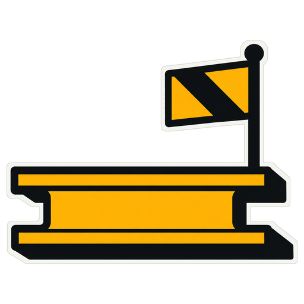
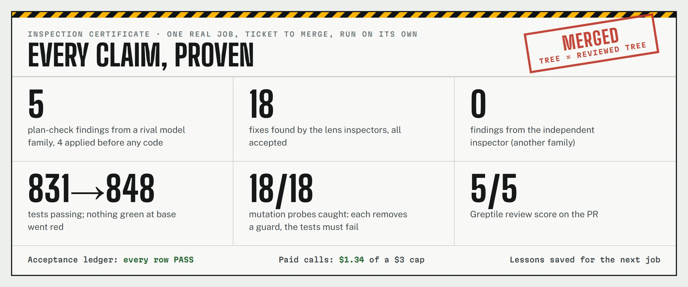
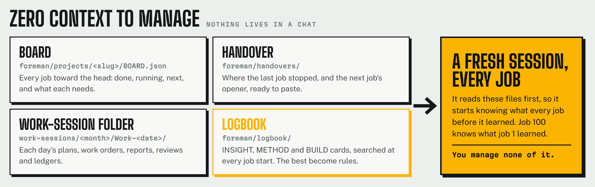
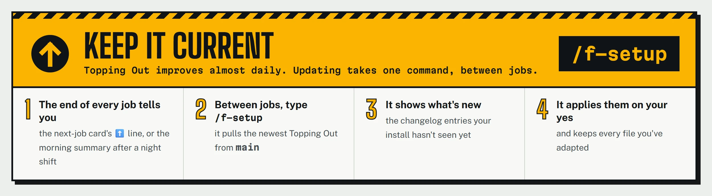
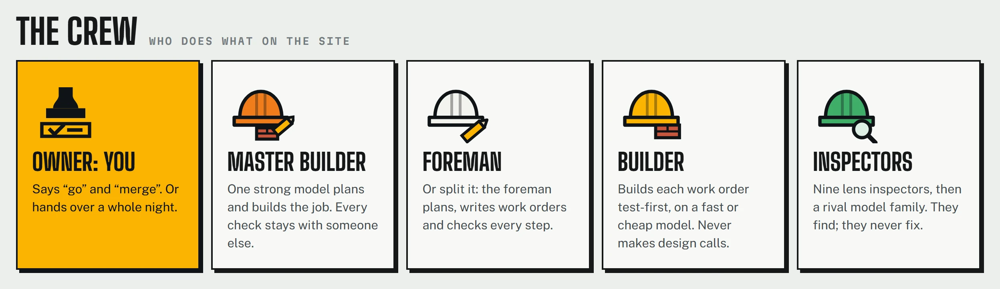
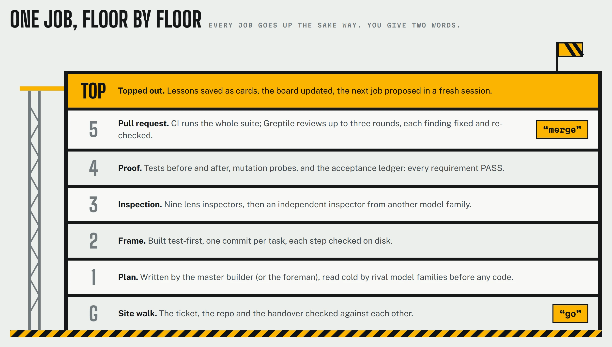
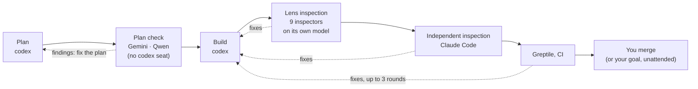
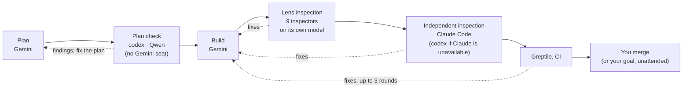
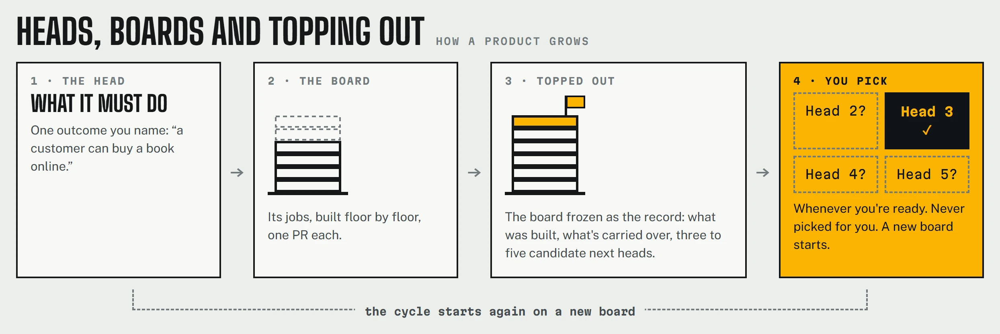

<p align="center">
  
</p>

<h1 align="center">Topping Out</h1>

<p align="center">
  Stop babysitting agents.<br>
  Get the proof.
</p>

<p align="center">
  <a href="LICENSE"></a>
  <a href="https://github.com/kaithoughtarchitect/toppingout/actions/workflows/ci.yml"></a>
  <a href="https://toppingout.dev"></a>
</p>

**Go to bed with a ticket list, wake up to merged PRs, each with its proof. Topping Out is a spec-driven software factory for Claude Code: it builds your product job by job, floor by floor, and nothing merges without evidence.**

Each job runs as one master builder (a strong model that plans and builds) or as a planner/executor split (a foreman plans, a fast or cheap builder codes), in a fresh session that starts from files, so the hundredth job knows what the first one learned. In Orca, it runs while you sleep.

| | |
|---|---|
| 🧱 **The problem** | One agent plans, builds and marks its own homework. On a long job it drifts, every new session starts from nothing, and your best model spends your usage on typing. |
| 🏗️ **The fix** | Run it like a building site. A master builder (or a foreman with a builder) builds, rival model families inspect, and you give the word. Every job's context lives in files, not in a chat. |
| 🧠 **The memory** | Nothing lives in a chat. The board, the handover, each day's work-session folder and the Logbook carry every job's context, so each fresh session starts knowing it all. You manage none of it. |
| 📋 **The proof** | Every claim needs a command, a commit or a test behind it. Every job ends with a record you can check. |

## What a finished job looks like

<picture>
  <source media="(prefers-color-scheme: dark)" srcset="assets/readme/receipt-dark.webp">
  
</picture>

<details>
<summary>The same job as text (the project's name and feature are left out)</summary>

```text
ticket      one feature, one branch, one PR
plan check  5 findings from a cross-family reader, 4 applied before building
build       work orders written by the foreman, built test-first by the builder you chose
inspect 1   lens inspection: 18 fixes found and accepted
inspect 2   independent review (another model family): no findings
review      Greptile 5/5
tests       831 -> 848 passing; no test red at head that was green at base
probes      18 of 18 mutation probes caught (each removes a guard; the tests must fail)
merge       merged tree identical to the reviewed tree
spend       at most 1.34 USD in paid calls, against a 3 USD cap
record      acceptance ledger, both inspections, base-vs-head runs, lessons saved as cards
```

Every PR is titled `J<N> · board <id>: <what it delivers>` (`METHOD.md` §10).

</details>

## Zero context to manage

<picture>
  <source media="(prefers-color-scheme: dark)" srcset="assets/readme/memory-dark.webp">
  
</picture>

**The Logbook** is the site's memory. Every job ends by writing what it learned as cards: **INSIGHT** (a gotcha, and why), **METHOD** (a way of doing something that worked) and **BUILD** (what the job built). Every job starts by searching them for its area, so the same mistake doesn't happen twice. Every tenth job it tidies itself, and the best cards are offered to you as rules, or as checks a script can enforce (`METHOD.md` §14).

## Try it

**How to start:**

1. `git clone https://github.com/kaithoughtarchitect/toppingout`
2. In Claude Code, in your project, say: `Read <path to toppingout>/skills/f-setup/SKILL.md and follow it`. It checks your tools, installs the skills and asks only what it can't find out.
3. Start your first job the way `/f-setup` suggests. It asks how you want to staff your jobs.
4. **Keep it current:** between jobs, type `/f-setup` again.

<picture>
  <source media="(prefers-color-scheme: dark)" srcset="assets/readme/update-dark.webp">
  
</picture>

## What you need

**The core kit**

| Tool | Its job on the site |
|---|---|
| Claude Code (your Claude subscription) | the foreman |
| Orca | the site itself: foreman and builder side by side (the pane link, no pasting), autonomous runs and night shifts |
| `git`, Node 18+, Python 3.9+, Bash | the installer and the checks (`/f-setup` checks each) |
| A builder: Pi, Claude Code or agy | the coding, on any model (a master builder can also be codex) |
| Codex CLI (your ChatGPT subscription) | the rival model family: the independent inspection and a plan-check seat |
| Pi and an OpenRouter key | the plan check's OpenRouter reader and the councils (needed with a master builder too); paid calls only within your cap |
| The Greptile app on your repo | up to three review rounds on every PR |

**Extras**

| Tool | Adds |
|---|---|
| Antigravity's agy CLI | a builder option and a free Gemini plan-check seat |
| A Linux server and Tailscale | jobs that run while your computer sleeps (`SETUP.md` §8b) |

Tested on Windows 11 and an Ubuntu 24.04 server through Orca; macOS and desktop Linux expected to work, not yet verified (`SETUP.md` §9).

## The crew

<picture>
  <source media="(prefers-color-scheme: dark)" srcset="assets/readme/crew-dark.webp">
  
</picture>

<details>
<summary>Site words</summary>

| Word | On this site |
|---|---|
| Work order | a file of exact tasks, each with its tests and its own commit; the builder gets a one-line pointer to it |
| Site walk | the foreman's check that the handover still matches the repo and the live ticket |
| Plan check | a cold read of the plan by rival model families, before any code (`/f-plancheck`) |
| Lens inspection | nine review agents, one per angle: tests, errors, types, code, comments, simplify, loose ends, migrations, instructions (`agents/lens-*.md`) |
| Independent inspection | a fresh session from another model family |
| Acceptance ledger | every requirement with its evidence; every row PASS before the merge |
| Board and head | the project's jobs drawn as a fishbone; the head is what the product must do |
| Topping out | when a building's last beam goes on; here, when a board reaches its head |
| Pane link | Orca running the foreman and the builder side by side (`skills/orca-pi-connect`) |

</details>

## One job, from your side

<picture>
  <source media="(prefers-color-scheme: dark)" srcset="assets/readme/floors-dark.webp">
  
</picture>

1. Give the foreman a ticket: a tracker link, or a short `TICKET-<nn>-<slug>.md` (`/f-survey` turns an idea into one).
2. It walks the site, then asks for your **"go"**.
3. It writes work orders; you paste each pointer into the builder (or the pane link does it), until the build, the two inspections and the acceptance ledger are done. A master builder builds it itself.
4. On your word ("open the PR") it opens the PR and runs up to three Greptile review rounds on it. You say **"merge"** when the evidence satisfies you.
5. It closes the job, saves the lessons, and proposes the next ticket for you to confirm.

<details>
<summary>Every step, as the foreman runs it</summary>

**Before any job**, a big plan is cut into tickets: `/f-survey` → `/f-blueprint` → **`/f-plancheck`** → **`/f-schedule`** (`METHOD.md` §13).

```
 SHIFT HANDOVER + OPENER ──> SITE WALK ──> [owner: "go"]
                                          │
          BUILDER PRE-FLIGHT (read-only env check) ── READY / BLOCKED
                                          │
 WORK ORDER 1  setup + baseline (worktree, job file, t0 captures) ── no code
                                          │
 GATE 1   /f-plancheck on the foreman's own plan (cold seats, other families; before work order 2)
                                          │
 WORK ORDER 2  "plan in force + T1" (the foreman wrote and validated the plan)
                                          │
 WORK ORDER 3..N  one or several decision-complete tasks per work order, test-first, one commit per task
      │  after EACH: disk check → work order review (re-probe, verify test-first, switch-rule line)
                                          │
 BASE-VS-HEAD  builder work order (the tests that use what changed); any red-at-head-only = STOP
 GATE 2   foreman reviews every commit + checks the builder's base-vs-head on disk
 LENS INSP.    /f-inspect: nine fresh lens agents ──> each finding checked ──> repair work orders (QUICK: skipped)
                                          │
 CROSS-MODEL   /pack-review ──> a fresh session of another family runs /xreview ──> /adjudicate ──> repairs
 FINAL RE-RUN  captures, probes, base-vs-head; the whole suite once, each red test labelled
 ACCEPTANCE LEDGER  every requirement row PASS (CI green at the final head) to merge
                                          │
 PR opened ──> /f-greploop: ≤3 Greptile rounds ──> [owner: "merge"]
                                          │
 /f-signoff (+ Logbook cards) ──> dev report ──> next ticket, you confirm ──> /f-board close ──> handover + opener
```

A master builder job runs the same checks in one session, without the work orders (`METHOD.md`, "MASTER BUILDER").

</details>

## Two ways to staff a job: foreman and builder, or a master builder

| | Master builder | Foreman and builder |
|---|---|---|
| **Use it when** | you want your strong model to build too: a frontier model can plan and build a job of any difficulty itself | you want a very fast model, or a cheaper and less capable one, doing the coding |
| **Why** | no handoffs and no work orders; every check stays the same | a strong foreman plans, writes exact work orders and reviews every step, so the builder can't drift or make design calls |
| **The model** | one strong model doing both, in Claude Code, codex or agy | a strong foreman; the builder on anything |

Your first job asks which you want; it carries over until you change it ("go, master builder" / "go, foreman", or in a goal).

**A master builder in Claude Code.** Dotted arrows are repair loops: every accepted finding goes back, is fixed test-first and checked again.


The plan-check seats are your standing choice minus the master builder's own family.

**A master builder in codex:**



**A master builder in agy, on a Gemini model** (agy on a Claude model reads like the Claude Code chart):



## Three ways to run a job

| | How | You |
|---|---|---|
| 👤 **With you** | paste the job's opener into a fresh session | give each word yourself |
| 🤖 **Autonomous run** | `/goal autonomous run: <opener path>, until done or stopped` | come back to a merged PR |
| 🌙 **Night shift** | `/goal night shift: jobs 13, 17, until done or stopped` | read the morning report |

With an autonomous-run goal, a job runs to the merge without you (with the pane link carrying the pointers), inside the grants `RULES.md` ("The one exception") lists; it repairs what goes red and stops only on the conditions listed there. Any other standing goal grants nothing. A night shift runs several autonomous runs in a row, each in a fresh session, needs Orca, and ends at any stop. At the end of each job, a **🚧 YOUR CALL** card offers the three ways for the next one, each line ready to paste.

## Site rules

1. One ticket, one job, one branch, one PR.
2. Whoever builds never inspects their own work; a foreman never writes product code.
3. Everything goes through files, never pasted text.
4. Disk before words: the foreman checks the commits before it reads the report.
5. A claim without evidence counts as not done.
6. Merges, pushes, messages and migrations wait for your typed word (`RULES.md`).
7. No agent marks its own homework.

## Heads, boards and topping out

<picture>
  <source media="(prefers-color-scheme: dark)" srcset="assets/readme/cycle-dark.webp">
  
</picture>


Every project's jobs, drawn as a fishbone toward its head (`examples/example-board/board.html`). Solid is merged, yellow is in progress or next, dotted is blocked. The icons say what a job needs to run: 🌐 a browser, 👤 you, 🖥️ a screen, 🔑 a login (by name, never the password). "Needs you" lists what to set up before tonight's jobs.

**Topping out.** When a board reaches its head (every job merged or resolved), the end game freezes it as the project's record, writes what was built and what's carried over, and offers three to five candidate next heads. You pick one, whenever you're ready, and the cycle starts again on a new board (`METHOD.md` §11b).

## What it is not

- **Not autonomous by default.** You give the word for every push, PR, review round and merge. Autonomy comes only from an explicit grant: an autonomous run or a night shift, for the jobs it names (`RULES.md`, "The one exception").
- **Not a guarantee.** Independent reviewers reduce failure modes; they don't promise correct code.
- **Not tied to one builder.** Any agent that can read a file, run a shell and write a report can build (`Builder-Playbook.md`).

## What software enforces, and what is only instructed

🔒 **Locked by a script:** the end-game lock, the merge-on-main check, the reviewer seated on another vendor's CLI (when used), the names check on records, the voice add-on's refusal of a bare "merge".

📋 **Site rule (the agents follow it):** waiting for your word (plus your tool's own permission prompts), and the acceptance ledger's PASS rows.

<details>
<summary>Each promise, and what isn't prevented</summary>

| Promise | Enforced today by | What is not prevented |
|---|---|---|
| Gated acts (push, merge, messages) wait for your word | **instruction** (`RULES.md`), plus your coding tool's own permission prompts. The package ships no hook that blocks a gated act | an agent with push rights and pre-allowed commands can push; nothing in the package blocks it technically. `SETUP.md` §5 suggests a hook for migrations only, and `SETUP.md` §7 asks you to pre-allow `git push`, `gh pr create` and `gh pr merge` for an autonomous run |
| A voice message never stands in for your word | **a script in the voice add-on, plus instruction:** Topping Out Gaffer refuses to send a message that is only a gated act ("merge", "push", "open the PR", "greploop") and marks every message it sends `[voice]` (`addons/gaffer/brain.ts`); `RULES.md` says a `[voice]` message is never the owner's word | the refusal covers only a message that is the gated act alone; any other `[voice]` message reaches the session, where only the instruction stops it |
| What merged is what was reviewed | **a check the foreman runs:** the merged commit's tree must equal the reviewed and tested tree (`METHOD.md` §10 step 3), and `skills/f-signoff/endgame.mjs verify-merge` refuses a close whose merge isn't on the main branch | with one lane the tree comparison is not scripted (in lane mode `snippets/land_tested.sh` refuses to push a merge whose tree differs from the proven head's, and its `verify` checks the landed merge), and `verify-merge` checks only that the merge commit is on main (and runs because `/f-signoff` calls it); an edit after the final re-run invalidates the acceptance and is caught only if the foreman re-runs, as the rules require |
| Nothing new starts until a closed job's end game is done | **a script the skills run:** `endgame.mjs` keeps a lock file (one per lane with two lanes); the planning skills and work order 1 run its `check` and stop while it exists | an agent that skips the `check` call isn't stopped |
| The review is independent | **a script, when used:** `scripts/cross-review-dispatch.mjs` seats the reviewer on another vendor's CLI, in a separate process, from a brief (`/pack-review`) | the foreman (or the master builder) writes the brief, so it chooses what the reviewer is pointed at and told (the reviewer can also read the checkout, read-only); seats exist only for Claude, codex and Gemini hosts; this is separation, not adversarial isolation |
| The whole ask is done | **instruction plus a record:** the acceptance ledger lists every requirement and check with its evidence, and `/f-signoff` refuses unless every row is PASS. A change to the ask is recorded in the owner's own words (`METHOD.md` §2) | the ledger is written and checked by agents; a wrong PASS is caught only by the reviews or by you |
| Builder names stay out of the records | **a script the foreman runs:** `skills/f-signoff/names-check.mjs` checks every staged record at the records push and exits non-zero on a hit | it runs only when the foreman calls it at the records push; it checks only the names in your names file, and skips allowed contexts and rendered board pages |

</details>

## Updating

Between jobs, type **`/f-setup`** in your project. It takes the newest Topping Out from `main`, shows what's new (`CHANGELOG.md`), applies it on your yes and keeps every file you've adapted. Check without changing anything: `node <path to toppingout>/skills/f-setup/install.mjs --repo . --check`.

## Read next

| If you are... | Read |
|---|---|
| The owner | this README → `METHOD.md`, "The owner's loop" |
| Setting it up | `SETUP.md` |
| A new foreman | `RULES.md` → `METHOD.md` → `OVERRIDES.md` → `Foreman-Playbook.md` |
| Running a builder | `Builder-Playbook.md` |
| An AI tool | [toppingout.dev/llms.txt](https://toppingout.dev/llms.txt) |

<details>
<summary>Folder map, and which file wins</summary>

| Path | What it is |
|---|---|
| `METHOD.md` | the full method, stage by stage, with the "why" behind each step |
| `RULES.md` | the non-negotiables, and the acts that need the owner's word |
| `OVERRIDES.md` | where the method beats the bundled skills and agents |
| `SETUP.md` | installing, requirements, the tested setup |
| `Foreman-Playbook.md`, `Builder-Playbook.md` | how to do the foreman's part well, and how to run any builder |
| `CHANGELOG.md`, `ROADMAP.md`, `CONTRIBUTING.md` | what changed, what's next, how to help |
| `DESIGN.md` | the look every Topping Out page shares |
| `flow.html` | the whole flow as one picture: 46 steps in seven stages |
| `skills/`, `agents/` | the 30 skills and the review lenses and helpers they call |
| `templates/`, `snippets/` | fill-in-the-blanks for every document the method writes, and code to copy |
| `scripts/` | the review dispatcher, the voice scripts and the generators for the site, the wiki and these pictures |
| `skills-wiki/` | the map of every skill and agent |
| `examples/example-board/` | a made-up project board: open `board.html` |
| `foreman/` | the Logbook, the blueprints index and the job templates |
| `addons/deep-agents/` | optional: for an agent built on LangChain, LangGraph or Deep Agents |
| `addons/gaffer/` | optional, in this repo only: Topping Out Gaffer, a voice agent for your boards and live sessions (`SETUP.md` §8c) |
| `docs/`, `assets/` | the site at toppingout.dev, generated by `scripts/build_site.py`, and its images |

**When two sources disagree:** the owner's own words → `RULES.md` → `METHOD.md` → `OVERRIDES.md` → `SETUP.md` → the playbooks → `templates/` → the bundled `skills/` and `agents/`.

</details>

**Contributing:** issues and pull requests welcome (`CONTRIBUTING.md`). If this saves you a babysitting session, a star helps others find it.

## Licence

MIT. See `LICENSE`.
